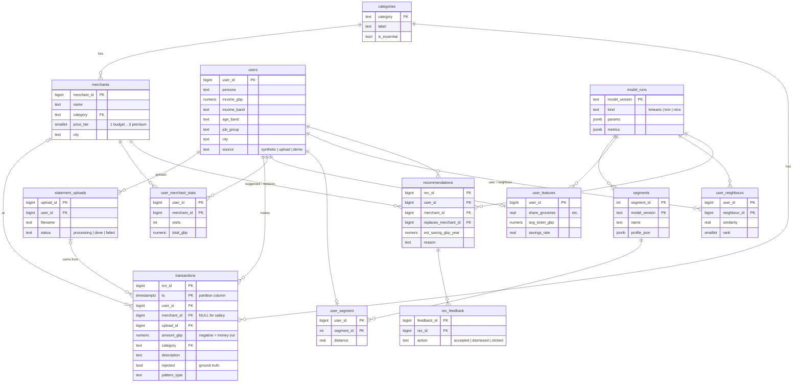

# 🐯 Database (`db/`)

Everything the app stores lives in one shared **Tiger Data** (TimescaleDB on Postgres) database. This folder holds the schema, as numbered SQL migrations, and a few helper scripts.

> First time? Put `DATABASE_URL` in `.env` (ask for it privately), then run the commands in [Commands](#commands).
> For a gentler intro to Tiger, read [docs/TIGER_DATA.md](../docs/TIGER_DATA.md).

---

## How data flows

```mermaid
flowchart LR
    CSV["📄 Kaggle CSVs<br/>data/raw/ (gitignored)"] -->|conversion script| SRC
    UP["📤 User uploads<br/>a bank statement"] -->|API| SRC

    subgraph DB["🐯 Tiger Data"]
        SRC["Source data<br/>users · merchants · transactions"]
        AGG["Continuous aggregates<br/>monthly_category_spend · daily_cashflow"]
        ML["ML outputs<br/>segments · neighbours · recommendations"]
        SRC -->|refreshed hourly<br/>+ refresh_aggregates()| AGG
    end

    SRC -->|read| JOB["🤖 ML batch job<br/>k-means + KNN"]
    JOB -->|write| ML
    AGG -->|read| API["⚙️ FastAPI"]
    ML -->|read| API
    API --> FE["🖥️ Frontend"]
```

The app **only reads** precomputed results. A new upload is compared against stored data without retraining.

---

## Tables



### Source data (`001`, `002`)

| Table | What it holds |
|---|---|
| `categories` | The 16 categories (`groceries`, `eating_out`, `coffee`, ...), each flagged essential or not |
| `users` | One row per person. **No gender column**, on purpose (fairness). |
| `merchants` | UK shops, each with a `price_tier` (1 = budget, 3 = premium). Unique on `(name, city)`. |
| `statement_uploads` | One row per uploaded CSV |
| `transactions` | **Hypertable**, split into 1-month chunks on `ts`. `amount_gbp` is **negative for money out**. `injected` and `pattern_type` are ground-truth labels for testing our detectors. |

### Continuous aggregates (`003`)

Summary views that Tiger keeps up to date. **Query these for charts, not `transactions`.**

| View | Columns | Used for |
|---|---|---|
| `monthly_category_spend` | `month, user_id, category, spend_gbp, txn_count` | "Where your money goes" |
| `daily_cashflow` | `day, user_id, money_in_gbp, money_out_gbp, txn_count` | Payday forecast |

- They refresh **hourly**, and also show brand-new rows straight away (`materialized_only = false`).
- ⚠️ **Uploads have past dates, which the hourly refresh doesn't pick up.** After inserting one, call `refresh_aggregates(first_ts, last_ts)` from `db.py`.

### ML outputs (`004`)

These are normal tables, rebuilt by the batch job. Empty them with `reset_derived.py --yes`.

| Table | What it holds |
|---|---|
| `model_runs` | One row per training run: version, params, metrics (silhouette, precision@5, ...) |
| `user_merchant_stats` | Visits and spend per user per shop. **KNN input.** |
| `user_features` | One row of numbers per user. **K-means input.** |
| `segments` / `user_segment` | The ~6 "people like you" groups, and which group each user is in |
| `user_neighbours` | Each user's 20 most similar users |
| `recommendations` | "Shop at Lidl instead of Waitrose, save £310/yr" |
| `rec_feedback` | What users did with each recommendation |

### Old raw tables

`kaggle_transactions` and `kaggle_daily_spend` hold the original Kaggle columns (`cc_num`, `amt`, ...). They are filled by `uv run tiger-load`, and **the app doesn't use them.**

---

## Rules

1. **Nothing may reference `transactions` with a foreign key.** Postgres doesn't allow it on hypertables.
2. **Deleting a user deletes everything about them** (`ON DELETE CASCADE`). That's how "delete my data" works.
3. **Never edit a migration that's already applied.** Add `005_something.sql` and run `migrate.py`.
4. **Always use `%s` placeholders**, never f-strings, in SQL.
5. Free plan = 750 MiB. Load about 200 users, not all 1.85M rows.

---

## Commands

```bash
uv sync                                    # install dependencies
uv run python db/migrate.py                # create/update tables (safe to re-run)
uv run python db/verify.py                 # smoke test → ALL CHECKS PASSED
uv run python db/delete_user.py 42 --yes   # delete user 42 and all their data
uv run python db/reset_derived.py --yes    # empty the ML tables before a rebuild
```

| File | What it does |
|---|---|
| `db.py` | `get_conn()` and `refresh_aggregates(start, end)` |
| `migrate.py` | Runs `migrations/*.sql` in order and records each in `schema_migrations`. Skips `099_*`. |
| `verify.py` | Inserts test data, checks the hypertable, aggregates and deletion, then cleans up |
| `delete_user.py` | "Delete my data" demo, then refreshes the aggregates so the user's totals vanish too |
| `reset_derived.py` | `TRUNCATE` of the ML tables only. Refuses to run without `--yes`. |
| `migrations/099_columnstore_optional.sql` | Compression (`segmentby user_id`). **Not applied.** Run it by hand once loading is finished. |
