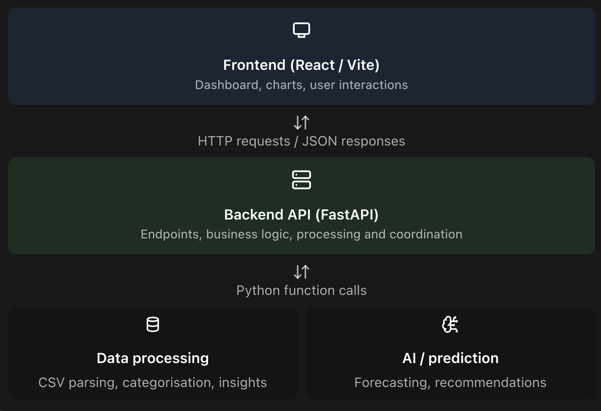

# Deez-Bugs
hack the burgh 2026
## ▶️ Run it

```bash
./run.sh            # backend + frontend, opens http://localhost:5173 (Ctrl+C stops both)
./run.sh backend    # backend only  → http://localhost:8000/docs
./run.sh frontend   # frontend only → http://localhost:5173
uv run runserver    # backend only, the Python way (uv run runserver 8001 for another port)
```
First time: `cp .env.example .env` and paste the real `DATABASE_URL` (ask privately). Needs `uv` and Node 20.19+ (`brew install uv node`).

# Project Idea
An AI-powered financial assistant that analyses a student's spending, predicts future expenses, identifies potential savings and autonomously researches cheaper alternatives.

Think of it as a financial assistant that doesn't just tell you where your money went, but helps you decide what to do next.

## How it works
Imagine a student uploads their bank transaction CSV.

The application:
1. Analyses spending: Categorises transactions into rent, food, transport, entertainment, subscriptions, etc.
2. Identifies hidden costs: Highlights recurring subscriptions, spending patterns and unexpected expenses.
3. Predicts future spending: Estimates expenditure by the end of the month and predicts whether the student will exceed their budget.
4. Makes recommendations: Identifies areas where the student could save money.
5. Uses an AI agent: Researches cheaper alternatives online and presents potential savings.
For example:
You've spent £184 on groceries this month. Based on your spending patterns, you're projected to spend £245 by month-end. We found alternative shopping options that could potentially save you £30–£40 monthly.

## Challenges it enters
Sponsor	What we demonstrate
Bank of Scotland	Helping students make better financial decisions and save money
HRT	Predictive expenditure modelling and data-driven recommendations
G Research	Making hidden spending patterns and future financial consequences visible
Wordsmith	An autonomous browser agent researching cheaper alternatives

## MVP 
1. CSV upload and transaction processing
   
   Upload a sample bank statement, parse transactions and categorise expenditure.
2. Financial dashboard
   
   Display spending breakdowns, monthly expenditure and recurring payments.
3. Predictive analytics
   
   Forecast end-of-month spending using historical transaction data and simple statistical models.
4. AI recommendations
   
   Generate personalised financial recommendations based on the user's actual spending.
5. Browser research agent
   
   Give the agent a task such as finding cheaper grocery options. Have it navigate websites, gather information and return comparisons.

Stretch features
- Interactive what-if financial simulations.
- More sophisticated forecasting.
- Automatic identification of subscriptions.
- Multiple supermarket comparisons.
- Conversational financial assistant.

## Milestones
Time	Objective
Hours 0–2	Agree architecture, divide tasks, establish Git repository
Hours 2–6	CSV processing, categorisation and financial calculations
Hours 4–9	Frontend dashboard and visualisations
Hours 7–12	Predictive analytics and AI recommendations
Hours 10–16	Browser automation agent
Hours 16–19	Integrate frontend, backend and agent
Hours 19–22	Testing, bug fixes and polish
Hours 22–24	Presentation and demonstration preparation

## Overview

## Database
All data lives in a shared Tiger Data (TimescaleDB) cloud database. **New to the project? Start with [TIGER_DATA.md](TIGER_DATA.md)**: it covers getting connected in 5 minutes, what tables exist, and how to query them from Python.

- **Schema:** plain SQL in [`db/migrations/`](../db/migrations/). `transactions` is a hypertable (1-month chunks), and `monthly_category_spend` and `daily_cashflow` are continuous aggregates that refresh hourly. The ML outputs (segments, neighbours, recommendations, `model_runs` with metrics) are normal tables.
- **Setup:** put `DATABASE_URL` in `.env` (see `.env.example`), then:
  ```bash
  uv sync
  uv run python db/migrate.py   # safe to re-run
  uv run python db/verify.py    # should end with ALL CHECKS PASSED
  ```
- **Delete my data:** `uv run python db/delete_user.py <user_id> --yes` removes a user and every row about them, including their totals in the aggregates.
## Frontend
The web app lives in [`frontend/`](../frontend/). Run it with `cd frontend && npm install && npm run dev`, then open http://localhost:5173 (add `?demo` to skip straight to the dashboard). **Backend team:** the JSON shapes the UI expects are in [`frontend/src/types.ts`](../frontend/src/types.ts). See [`frontend/README.md`](../frontend/README.md).
